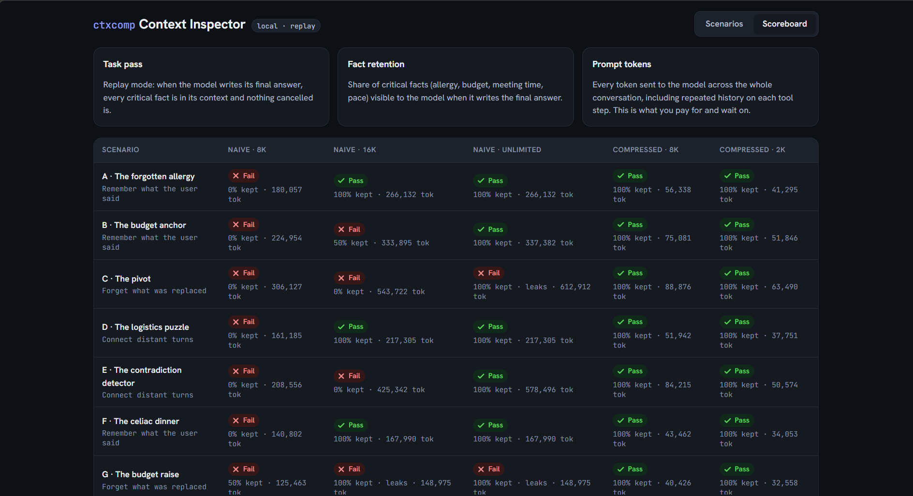
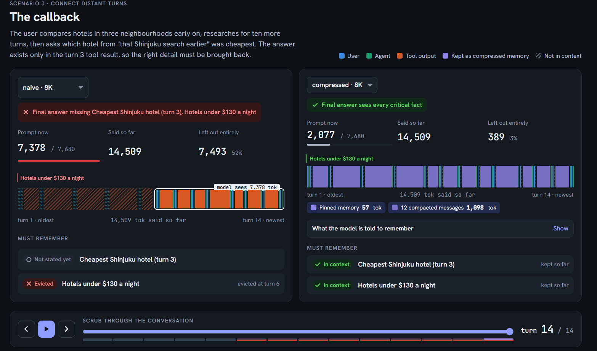
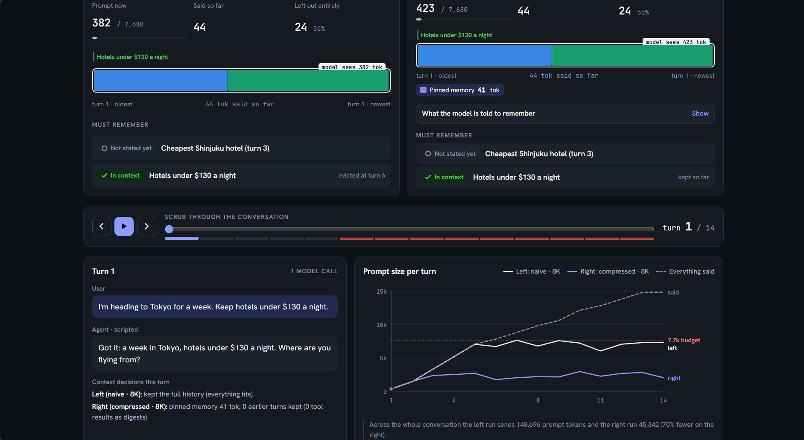

# ctxcomp: Context Compression for AI Agents

A plug-in context compression module for tool-using agents, plus the test bed that proves it works: a multi-city trip-planning agent, rule-based travel tools, ten long scripted conversations, an evaluation harness, and a web UI that shows what the agent's context window holds at every turn.

**Result (deterministic replay, 10 scenarios):** a naive agent with an 8K window passes **0/10**; with ctxcomp it passes **10/10 at 8K and still 10/10 at 2K**, while sending **67% fewer prompt tokens** than the naive 8K agent and **80% fewer** than an agent with unlimited context, which itself only passes 7/10.


*The Context Inspector Scoreboard: ctxcomp (right) achieves 10/10 across 8K and 2K, while the naive baseline fails due to forgetting (8K) or leaking stale facts (Unlimited).*

## The problem

Small open-source models run with 8K–16K windows, and a trip-planning agent fills that in a few turns: one hotel search returns ~1,800 tokens of JSON. The usual fix, dropping the oldest messages, forgets indiscriminately: a severe shellfish allergy from turn 1 goes as easily as a stale weather report. A bigger window doesn't fix it either. It costs far more, and it keeps cancelled plans and superseded numbers alive next to the current ones.

## Results

### Before vs after

| Agent | Window | Scenarios passed | Critical facts kept | Stale info leaked | Prompt tokens (all 10) |
|---|---|---|---|---|---|
| naive (drop oldest) | 8K | **0/10** | 5% | 0/2 | 1.66M |
| naive | 16K | 5/10 | 65% | 1/2 | 2.50M |
| naive | unlimited | 7/10 | 90% | **2/2** | 2.73M |
| **ctxcomp** | **8K** | **10/10** | **100%** | **0/2** | **0.54M** |
| ctxcomp | 4K | 10/10 | 100% | 0/2 | 0.54M |
| ctxcomp | 2K | 10/10 | 100% | 0/2 | 0.39M |

At the final turn, ctxcomp's prompt is 2.4x–12x smaller than the conversation it represents (median about 5x).


*Scenario J (The Callback): The baseline (left) forgets the turn-3 fact and maxes out its context window at 7,378 tokens. ctxcomp (right) retrieves the fact, compresses old messages into digests, and fits the prompt into just 2,077 tokens.*


*The prompt-size chart shows ctxcomp's prompt (blue line) staying flat well under the budget limit, while the naive baseline (grey line) hits the ceiling.*

### Ablation: what each component contributes


`python -m ctxcomp ablate` turns one component off at a time:

| Strategy | 8K | 3K | 2K |
|---|---|---|---|
| naive | 0/10 (1,658k tok) | 0/10 (569k tok) | 0/10 (327k tok) |
| **compressed (full)** | **10/10 (541k tok)** | **10/10 (507k tok)** | **10/10 (390k tok)** |
| without pinned memory (ledger) | 10/10 (515k tok) | 6/10 (486k tok) | 1/10 (381k tok) |
| without tool-output digests | 10/10 (1,683k tok) | 9/10 (666k tok) | 9/10 (400k tok) |
| without invalidation | 8/10, 2 leaks (568k tok) | 9/10, 1 leak (524k tok) | 9/10, 1 leak (395k tok) |
| without retrieval | 10/10 (541k tok) | 10/10 (508k tok) | 9/10 (390k tok) |

What this shows:
- At 8K the components back each other up. Digests alone make the whole history fit, so
  the ledger isn't needed; without digests the ledger alone keeps the facts, at 3x the cost.
- Invalidation is the one component nothing else replaces: without it, cancelled plans
  and replaced budgets leak at every window size.
- As the window shrinks, every component becomes necessary. At 2K, removing any single
  one loses at least one scenario; removing the ledger loses nine.

### Live Mode Results (Ollama)

Live evaluation reveals a distinction between context preservation and end-to-end task success.

| Model | Agent | Scenarios passed | Critical facts kept | Prompt tokens (all 10) |
|---|---|---|---|---|
| SmolLM2-1.7B | naive (drop oldest) | 1/10 | 0% | 3.02M |
| SmolLM2-1.7B | **ctxcomp** | **1/10** | **82%** | **0.47M** (84.4% fewer) |
| Qwen 2.5-7B | naive (drop oldest) | 3/10 | 15% | 1.05M |
| Qwen 2.5-7B | **ctxcomp** | **3/10** | **82%** | **0.44M** (58.1% fewer) |

With SmolLM2-1.7B, ctxcomp increased measured critical-fact retention from 0% to 82% while reducing reported prompt tokens from 3.02M to 0.47M (84.4%). With Qwen2.5-7B, retention increased from 15% to 82%, while reported prompt tokens fell from 1.05M to 0.44M (58.1%).

However, task success remained unchanged within each model: 1/10 scenarios for SmolLM2-1.7B and 3/10 for Qwen2.5-7B. This indicates that improved context availability alone was insufficient to produce reliable end-to-end behavior in these experiments.

Both models encountered difficulties generating the strict `<tool_call>` format required by the agent loop. This is a plausible contributor to the remaining failures, although tool-call parsing, argument validity, and model reasoning require separate measurements to establish the precise causes.

These findings motivate the project's two-part evaluation design: replay tests whether relevant information reaches the model, while live tests whether the complete agent can use that information to complete tasks. Context preservation is a necessary component of agent reliability, but it is not sufficient on its own.

*Retention is computed as the share of scenario-defined critical facts (regex-matched) present in the final prompt. At 82%, the missing facts were predominantly running budget totals (`spent`/`total_spent`), which depend on the model successfully calling the `budget_tracker` tool during the live run.*

## The ten scenarios

| | Scenario | Tests | Source |
|---|---|---|---|
| A | The forgotten allergy | shellfish allergy from turn 1, asked for dinner in a seafood market at turn 16 | problem statement |
| B | The budget anchor | $2,500 cap + $1,550 of bookings, needs "about $950 left" at turn 20 | problem statement |
| C | The pivot | Bali cancelled for Switzerland; summary must contain no Bali | problem statement |
| D | The logistics puzzle | Wednesday 2pm meeting from turn 1 decides the train day at turn 15 | problem statement |
| E | The contradiction detector | "max 2 activities per day" vs "book all of these" | problem statement |
| F | The celiac dinner | different wording of A ("celiac disease", pizza request) | added |
| G | The budget raise | budget raised mid-trip; the old cap must not be used | added |
| H | The wedding timing | different wording of D (wedding, "I land on Tuesday") | added |
| I | The next-day return | constraints must survive a new session | added |
| J | The callback | "the cheapest hotel from that Shinjuku search earlier" | added |

F–J use different wording from A–E so results don't depend on matching the given
phrasing. They found two real bugs during development (see "Failure analysis").

## How the compression module works

`CompressedContext` sits between the agent and the model. The agent reports events
(user message, tool call, tool result, reply); before every model call the module
assembles the prompt within a fixed token budget:

```
system prompt
pinned memory (ledger)          never evicted
  - constraints and preferences, as exact quotes of the user's words
  - budget: cap | total spent | remaining (computed, never summarized)
  - bookings; a note when a plan was cancelled; session number
relevant older turns            retrieved by keyword relevance to the current request
recent older turns              newest first, until the budget is full
  - user messages and replies kept (with superseded values redacted)
  - tool results replaced by one-line digests; duplicates collapsed
current turn                    verbatim: user message, tool calls, full tool results
```

### What is preserved, transformed and discarded

| Information | Treatment |
|---|---|
| Hard constraints (allergy, diet, budget cap, per-item price limit, fixed appointments, mobility) | **Preserved** verbatim in pinned memory; never dropped, even when the ledger is over budget; survive cancelled plans and new sessions |
| Soft facts (party, pace, trip length and dates, preferences) | **Preserved** verbatim in pinned memory; dropped oldest-first only if the ledger exceeds its share (25% of the window) |
| Spending | **Transformed** into computed numbers (cap, spent, remaining) from `budget_tracker` results |
| Current turn | **Preserved** verbatim, including full tool output |
| Older tool results | **Transformed** into digests (~10x smaller, every result name and price kept); duplicates become "same places as turn N"; raw output archived |
| Older user messages and replies | **Preserved**, newest first, while they fit; then **discarded** from the prompt (their facts live on in the ledger) |
| A cancelled plan ("scratch Bali") | **Discarded**: every earlier turn about it is invalidated, and mentions in later messages are redacted |
| A replaced value (old budget) | **Transformed**: the old amount is redacted wherever it appears in the history |

Every build is logged (`ctx.events`, `ctx.stats()`, `ctx.explain()`), e.g.
*"pinned memory 120 tok; 15 earlier turns kept (14 tool results as digests); cancelled-plan
turns ignored: 1, 2, 3, 4, 5, 6"*.

### Design decisions worth discussing

- **Quotes, not summaries.** Facts are stored as the user's exact words. A summary of
  "severely allergic to shellfish" can become "prefers no seafood"; a quote cannot drift.
  The optional model-assisted extractor is held to the same rule: it may only return
  quotes that appear verbatim in the message.
- **Numbers are computed, not remembered.** Budget arithmetic comes from tool results,
  because models are unreliable at carrying running totals through summaries.
- **The cancelled plan is not named.** The ledger says "the user cancelled an earlier
  plan" without naming it, because naming it invites the model to mention it.
- **Questions don't set constraints.** "Can we afford a $250 dinner?" is about the budget,
  not a new one (this was a real bug, below).
- **Plain Python, no model calls.** Compression is deterministic and costs no extra model
  calls by default, which keeps it fast and testable on small hardware.

### Failure analysis (found during development)

1. **A question overwrote the budget.** In G, "Can we afford a $250 dinner?" was read as a
   new $250 cap, replacing $2,400 and producing "remaining: -$1,770". Fix: questions and
   requests never set a cap, and per-item limits ("$200 a night") are tracked separately.
2. **"I land in Rome on Tuesday" was not recognized** as an arrival (only "arrive" was).
   Found by H failing at 2K. Fix: broader arrival phrasing.
3. **A case-insensitive pattern** tagged "$900 in total" as an itinerary ("3 in Paris").

## Mapping to the problem statement

| Requirement | Where |
|---|---|
| Compression mechanism and architecture | `ctxcomp/context/compressed.py`, this README |
| Agent integration point | `ContextManager` interface (`ctxcomp/context/base.py`); the agent only reports events and asks for a prompt |
| Baseline comparison | `NaiveContext`; every table above |
| What is preserved / transformed / discarded | table above |
| Token reduction / compression ratio | results tables, `compression_ratio` in `stats()` |
| Latency and cost | prompt tokens reported per run; per-call latency recorded in live mode |
| Task success, factual retention, coherence | replay retention checks + live answer checks |
| Omission / distortion rate | retention = 1 - omission rate; distortion prevented by verbatim quotes |
| Multi-session continuity | scenario I, `to_state()` / `load_state()` / `new_session()` |
| Interpretable memory artifacts | ledger text, decision log, Context Inspector |
| Reusable, not a one-off demo | strategy-agnostic agent loop, `pip install`-able package, CLI |
| Small open-source model with 8K/16K window | Ollama / OpenAI-compatible backends with `num_ctx` set from the window |

## Quick start

```bash
pip install -r requirements.txt
python -m unittest discover -s tests            # 46 tests

python -m ctxcomp eval                           # naive vs compressed, 8K, all scenarios
python -m ctxcomp eval --max-context 8192 2048 --strategies naive compressed
python -m ctxcomp ablate                         # the ablation table
python -m ctxcomp ui                             # Context Inspector in your browser
python -m ctxcomp ui --export inspector.html     # self-contained page to share
```

Reports are written to `results/` as JSON and Markdown.

## Running with a real model

Replay mode answers "did the right information reach the model?" Live mode answers
"did the model use it?" Run both: if replay passes but live fails, the problem is the
model, not the context.

```bash
ollama pull qwen2.5:7b        # reliable tool calls; 4-bit fits on an 8 GB GPU
ollama pull smollm2:1.7b      # the small model suggested by the problem statement

python -m ctxcomp eval --mode live --backend ollama --model qwen2.5:7b --strategies naive compressed
python -m ctxcomp eval --mode live --backend ollama --model qwen2.5:7b --strategies compressed --extractor llm
python -m ctxcomp ui --backend ollama --model qwen2.5:7b      # adds the Live chat tab
python -m ctxcomp chat --backend ollama --model qwen2.5:7b    # terminal; /memory, /stats, /newsession
```

Any OpenAI-compatible server (vLLM, llama.cpp server, LM Studio) also works:
`--backend openai --base-url http://localhost:8000/v1 --model <name>`.

Tip: very small models sometimes fail even with perfect context. Run the `unlimited`
baseline as an oracle to separate model failures from context failures.

## Context Inspector

`python -m ctxcomp ui` opens a dashboard. The whole conversation is drawn as a tape,
oldest on the left: solid segments are in the prompt word for word, violet ones are in the
prompt as digests, hatched ones are left out. Flags mark where each critical fact was
stated. Scrub or press play to watch the naive agent's window slide past the allergy
while the compressed agent keeps it. Each panel shows the exact memory text the model
receives, and each turn shows the context manager's decisions. The Scoreboard tab has
every scenario and run; the Live chat tab (with a model backend) shows the context tape
updating as you talk.

## Layout

```
ctxcomp/
  agent.py            travel concierge agent loop (strategy-agnostic)
  llm.py              backends: Ollama, OpenAI-compatible, ScriptedLLM (replay); tool-call parser
  messages.py         message / tool-call / call-record types
  tokens.py           token counting (heuristic by default, pluggable real tokenizer)
  tools/              web_search, places_search, weather_fetch, budget_tracker (synthetic data)
  context/
    base.py           ContextManager interface: the plug-in point
    naive.py          baseline: full history + sliding-window truncation
    compressed.py     the compression module (+ ablation variants)
    extract.py        fact extraction (heuristic, and model-assisted with a verbatim guard)
    digest.py         tool-output digests
  eval/               scenario loader, harness, answer checks, reports
  ui/                 traces, local server, Context Inspector page
scenarios/            A-J test conversations (YAML)
tests/                46 unit tests
```

## Using it in your own agent

```python
from ctxcomp.context import CompressedContext

ctx = CompressedContext(max_context_tokens=8192)
ctx.on_user(user_text, turn)
messages = ctx.build(system_prompt)        # fits the window; send these to your model
ctx.on_tool_call(call, turn); ctx.on_tool_result(call, output, turn)
ctx.on_assistant(reply, turn)

state = ctx.to_state()                     # JSON: persist between sessions
ctx = CompressedContext(); ctx.load_state(state)
```

## Limitations

- **Replay measures availability, not use.** It proves the facts reach the model. Whether
  a given model uses them is what live mode measures; those numbers depend on the model.
- **The default extractor is pattern-based** and English-only. It has known false
  positives (e.g. "it came in under $300" reads as a budget cap). The model-assisted
  extractor (`--extractor llm`) covers phrasing the patterns miss.
- **The scenarios were written alongside the module.** F–J use different wording to reduce
  overfitting, but the strongest test is new scenarios written by someone else.
- **Invalidation needs an explicit cancellation** of a named plan ("scratch Bali", "instead
  of Santorini"). An implicit change ("let's go somewhere colder") is not detected.
- **Retrieval is keyword-based** (TF-IDF over turns). It's enough here; embeddings would
  help with paraphrased references.
- Tool data is synthetic and token counts use a ~4 chars/token heuristic
  (`ctxcomp.tokens.set_token_counter` installs a real tokenizer).

- **Next step — Isolating live-agent failures:** Low task success cannot yet be attributed solely to model capability. Failures may arise from tool-call generation, prompt formatting, parser behavior, or reasoning. I plan to compare model-generated tool calls against known-valid tool calls while independently measuring parse success, tool selection, argument validity, and end-to-end task success. This will distinguish context-management failures from tool-interface and reasoning failures.

